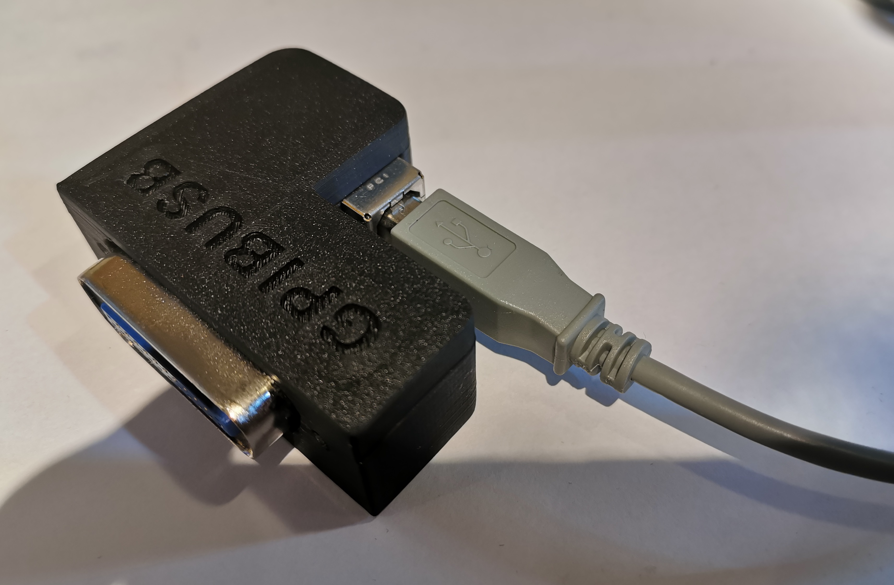
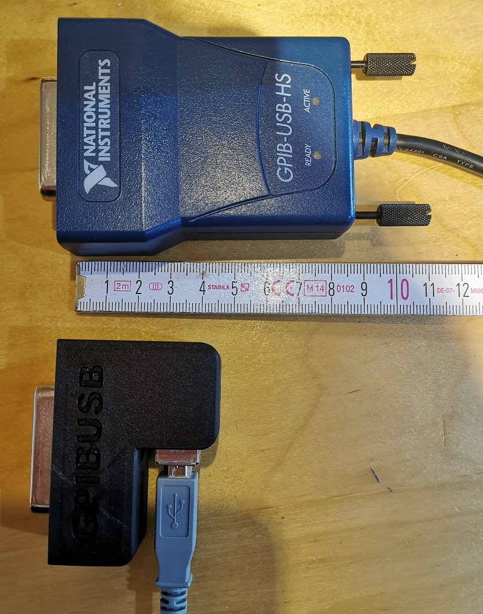
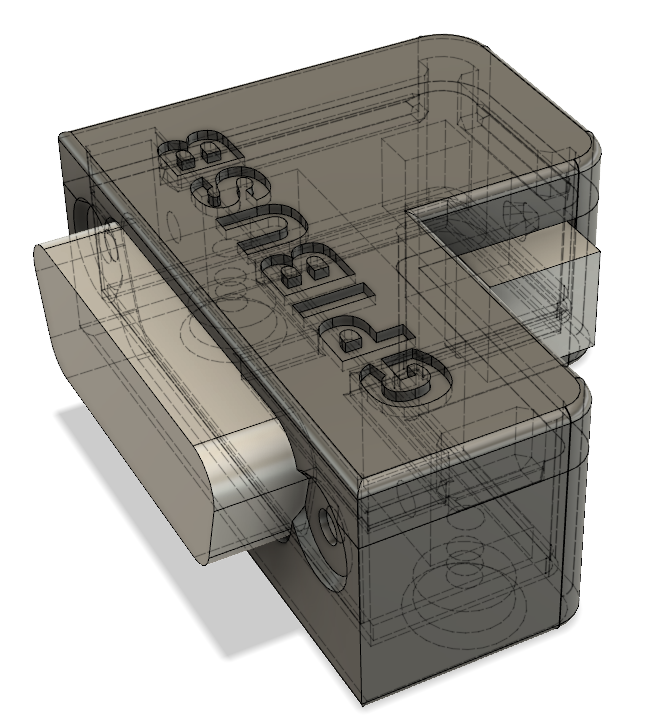
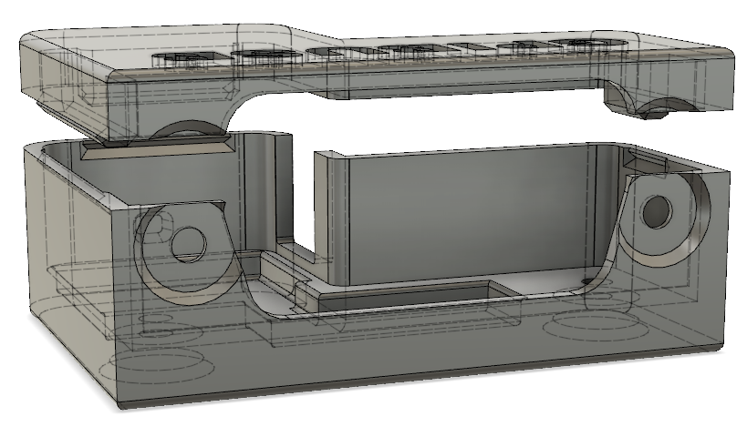
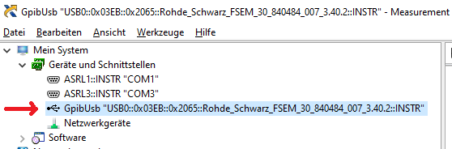
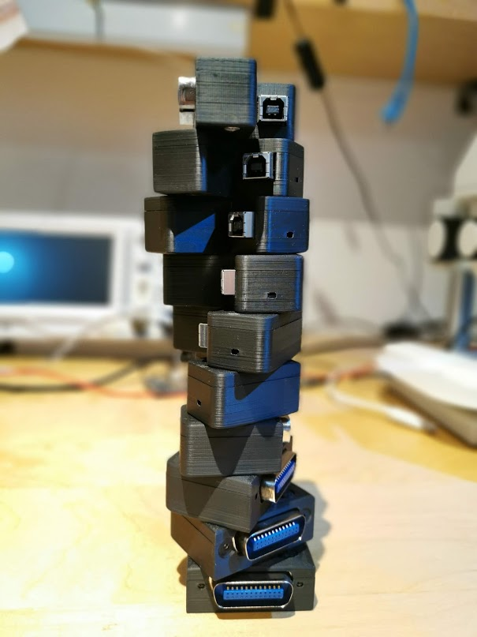

# Table of contents

:newspaper: [Latest updates](Updates.md)
<br> :hammer: [Buy it or build it](#buy-it-or-build-it)
<br> :wave: [UsbGpib Introduction](#usbgpib-introduction)
<br> :house: [Housing / Enclosure](#housings)
<br> :computer: [Software](#software)
<br> &nbsp; &nbsp; :electric_plug: [Using the device](#using-the-device)
<br> &nbsp; &nbsp; :gear: [Setting and getting parameters](#setting-parameters)
<br> :heavy_check_mark: [Testing status](#testing-status)
<br> :notebook: [Tutorials](Tutorials/README.md)
<br> :bulb: [Projects made with UsbGpib](#projects-made-with-usbgpib)
<br> :robot: [VisaMCP - AI control of your instruments](#visamcp---let-an-ai-assistant-talk-to-your-instruments)
<br> :rocket: [GPIBee, the successor](#looking-for-a-major-step-up)
<br> :heart: [Support the Project](#support-the-project)

# Summarized latest updates

For detailed visibility look under the Latest update link above!

[15th Nov 2026]: **Firmware V2.5** is out. It is a bugfix release, the details are in [Latest updates](Updates.md). Thanks to Andreas Tobler, who found and fixed most of the issues!

[15th Nov 2026]: Rick Fischer made a web front panel for the HP 6033A power supply, see [Projects made with UsbGpib](#projects-made-with-usbgpib).

[15th Nov 2026]: An experiment: [VisaMCP](#visamcp---let-an-ai-assistant-talk-to-your-instruments) lets an AI assistant control your instruments. It works with UsbGpib V2.

# Looking for a major step up?

**GPIBee** is the successor of UsbGpib:

- Ethernet with PoE in addition to USB. The Ethernet port is galvanically isolated.
- More host side protocols: USBTMC, VXI-11, the ++ protocol (Prologix/AR488 style) and native linux-gpib
- It can act as a remote GPIB gateway: reach your GPIB bus over the network, also from several PCs at the same time
- Multiple instruments on one adapter, each one with its own VISA resource. No address switching needed.
- Web front panels for your instruments without writing code
- Significantly faster than UsbGpib V2
- Parallel poll, auto discovery in the network (LXI, mDNS) and firmware updates from the browser

&#x1F449; Check it out at [www.gpibee.com](https://www.gpibee.com)

GPIBee is a commercial product. UsbGpib V1/V2 stays open source (MIT) and I keep maintaining it.

---

# Buy it or build it

* Tired of tinkering? Want to skip the hassle and get straight to using your GPIB setup?  
* You’d rather spend your time using your instruments instead of assembling hardware?

Skip the soldering iron and jump straight into your GPIB workflow!

You’ve got two solid options to get a ready‑to‑run UsbGpib adapter.

## &#x1f1fa;&#x1f1f8; - United States
* If you're in the US, you can now order the UsbGpibV2 directly from several sources, including my distribution partner Binho LLC. Enjoy fast domestic shipping with no long waits, no customs paperwork, and no surprises - just quick delivery and a smooth experience: 
<br> &#x1F449; <a href="https://binho.io/test-measurement/products/usbgpib-v2/" target="_blank">https://binho.io/test-measurement/products/usbgpib-v2/</a>
<br> &#x1F449; <a href="https://www.digikey.com/short/29nqq5cz" target="_blank"> https://www.digikey.com/short/29nqq5cz</a>
<br> &#x1F449; Amazon US also has it listed, but right now no stock, but worthwhile to check it out there too.

## &#x1F30E; - Worldwide
* I’ve teamed up with Elecrow to bring you ready-to-roll GPIB-USB converters – perfect for those who want results, not a weekend project.
* These adapters come fully assembled, programmed, housed, tested, and ready to go. No fuss. No build. Just plug it in and start working.
* The Adapters match 100% the V2 version described in this repository. 
* &#x1F449; <a href="https://www.elecrow.com/xyphrolabs-gpibusb.html" target="_blank">https://www.elecrow.com/xyphrolabs-gpibusb.html</a>

Let the data flow begin!

This doesn’t mean I’m going fully commercial - far from it.
Offering pre-built adapters is simply a convenience for those who’d rather skip the build and get straight to using their gear.

All sharing, support, and collaboration will remain fully open, just as before.
This is about choice, not change!

The full design files are located in this repository in case you want to build the devices yourself.

---

# UsbGpib Introduction
Versatile, cheap, portable and robust USB to GPIB converter (USBTMC class based).

You'll find many projects like this, but this one is special (ok, everybody will claim this) :-)

V1 Hardware: 


V2 Hardware: 


If you have a lot of test equipment at home, you might know the issues: Lots of devices only have GPIB as interface and the GPIB adapters and GPIB cables on the market are very expensive and some of them even have many issues, when run under Windows 10 (device driver does not work). Or they e.g. are not able to be operated with VISA, because they are UART based, need special command sequences, ...


The adapters are also typically very long, such that they extend the overall length of your test equipment by at least 10cm (~4 inches).

Apart of the 2 very big manufacturers, other GPIB adapters, e.g. with Ethernet or also USB interface are not recognized by normal VISA providers or PyVisa, making the measurement control implementation specific for your GPIB adapter.

I've got frustrated and tried to turn it into something positive. Here a video showing the final device in action - click to view:

[](https://www.youtube.com/watch?v=pZp1QZCXrF8) 


Some goals of the project were:
- Work based on the standard USBTMC protocol. This allows the GPIB test equipment to look like a normal USB based measurement device and work flawless with e.g. NI VISA, Labview, Matlab or PyVisa.
- Have a small length - otherwise my equipment has the risk of falling from the shelf :-) Also the USB cable should connect 90 degree angled, to make it very short. With V2 HW, the length got further reduced to the size of a GPIB connector.
- It should be cheap but still versatile (you can build a single one of these for only 14 USD!)
- It should support ALL my test equipment, from many different GPIB implementation generations and different GPIB flavors
- The Firmware should be upgradeable over USB
- It should be rock-solid (!) I don't want to end up in a very long measurement being interrupted because of a software issue of my USB GPIB converter.
- It should support additional features like serial poll, remote enabling/disabling
- If there is no GPIB device connected to the USBGpib converter, or the GPIB device is powered down, there should be no USB device visible on the PC.

All those goals are met.

---

# Hardware

## Microcontroller choice

Although I typically would prefer nowadays an ARM Cortex M0/3/4/7 controller, there is an issue with it. Available devices support only max. 3.3V supply voltages, such that there would be a requirement for a level-shifter towards the GPIB Bus.
GPIB is based on 5V (not exactly true, but a first iteration).

This limited the microcontroller choice to e.g. AVR or PIC controllers. Because of very good availability I ended up in ATMEGA32U4 controllers.
Apart of the device supporting 5V I/O voltages, it also does not require a regulator to be part of the application - it has an internal 3.3V regulator. This minimizes the full application schematic and BOM.

Apart from that, there is an excellent USB stack available [http://www.fourwalledcubicle.com/LUFA.php](http://www.fourwalledcubicle.com/LUFA.php).

The GPIB side of the schematic can be directly connected to the ATMega32U4 IO pins. The IO pins from the microcontroller side are only set to 2 different states: Tri-state (input) or output LOW, to talk over GPIB.

## Component sourcing

All components are easy to source, so I only specify the potential critical ones:

- 16 MHz Crystal: Farnell 2853867 - MCSJK-7E-16.00-8-30-100-B-30 
- REV 1 GPIB connector: Farnell 2421095 - NORCOMP 112-024-113R001. For REV 2 use a straight 24P male solder type connector e.g. from AliExpress.
- USB connector for V1 HW: Farnell 2668483 - Amphenol ICC 61729-1011BLF
- USB connector for V2 HW: Best is to look on AliExpress for 57 series 24P connector as a starting point.

## PCB

The PCB can be ordered at nearly any PCB pool production service (e.g. 10 PCBs for 2 USD + shipping). The gerber files are included in the "HW/Gerber files" subdirectory.

## Mounting the PCB & Flashing the firmware

The PCB is available in 2 revisions.
- [REV 1](HW/REV1/README.md) is the most popularly used right now due to age. It has a USB Type-B connector and an L-shaped housing visible on a few photos of this page.
- [REV 2](HW/REV2/README.md) has some improvements like being smaller, better fit and USB Type-C connector.
- A REV 3 is upcoming. It will be a major redesign with more speed, Ethernet and power over Ethernet support, but the same DNA: Standard protocols being used and ensure compatibility and stability!

Choose whatever you prefer. The software images, but also the external behavior is the same.

---

# Housings

## REV 1


I created a sophisticated 3D printable housing for this adapter. The design was made with Fusion 360. The project file + the STL files are included in the "Housing" sub directory.

The PCB fits perfectly into it. Optionally it can be fixed with 2 mounting screws (the GPIB connector has 2 threads, use 2 times 4-40 UNC x 3/8) and the TOP cover snaps onto the housing base.

I printed this using an Ender 5 3D printer with black PLA, 0.15mm layer height, 1mm wall thickness, no support.
Take care, that you rotate the TOP part of the housing by 180 degrees, so that the flat side is located on the printer bed.
Printing works fine, several iterations of the design were made to ensure good printability.
I printed so far 15 housings, without a single fail.

More information on this REV 1 can be found here: [REV 1](HW/REV1/README.md).
Note, that also the programming/build instructions moved to this location.

## REV 2


The REV 2 housing is a lot smaller, but requires 2 screws.
The housing is quite important to be able to connect and disconnect the board without breaking anything. It is key for mechanical stability of the adapter.
When operating the device without housing, take very well care when plugging in and out the board in case the GPIB connector has a very tight fit.

Information on how to build it can be found in the HW/REV 2 folder: [REV 2](HW/REV2/README.md).
Note, that also the programming/build instructions moved to this location.

---

# Software

## Source code

The source code of the Boot loader (slightly modified LUFA MassStorage Boot loader) and the main USBGPIB converter are located in the "SW" subdirectory.
At the time of publication LUFA 170418 release was used, with GCC as compiler.

Note: The Software is compatible with any HW revision in this repository. For REV 1 and REV 2 hardware you don't need different SW images.

The current firmware version is V2.5.

## Tests

"SW/Tests" contains a Python test for the internal commands (the ones starting with "!"). It needs pyvisa and pytest and an adapter plugged into a powered instrument:
```
python test_internal_commands.py -v
```

## Binaries

For those, that just want to create their own device, I've included the binary output in the "SW/binaries" subdirectory.

---

# Using the device

## USB enumeration

You might be surprised initially, that the device does not show up in your device manager (or lsusb), when you connect only the USB side. This is a feature, not a bug (really!).
Only, if a GPIB device is connected, you can see the device on your PC too.

The reason behind the feature is simple: Instead of having a standard GPIB wiring, where you have a single GPIB controller and lots of GPIB devices interconnected, USBGPIB supports only a direct connection of the USBGPIB device to your measurement device. If you have like me e.g. 14 Instruments you don't want all to show up in the device manager, if the measurement device itself is powered down - you won't anyway be able to communicate with a powered down device.

When USB and the GPIB side is connected, the device enumerates. The USBGPIB device reads out the ID of the instrument and constructs a unique USB Serial number out of it. It is thus easily possible to assiate multiple connected USBGPIB devices with the measurement instrument.

The VISA ressource name is constructed from this USB Serial number. You can identify easily e.g. in NiMax, which device is connected:



If you connect your USBGPIB device afterwards to another GPIB measurement device, it will disconnect and connect with a new serial number string, matching the other GPIB device *IDN? response again.

## GPIB settings on your measurement device

GPIBUSB does probe all GPIB primary addresses (and secondary address 0) for presence of a GPIB Talker/listener. It is thus not required to set a specific GPIB address - GPIBUSB will find it itself.

The only importance setting on the measurement device is, that the GPIB interface is enabled, which is typically the case.

## LED indicator

The LED indicates different states:

LED blinking: The USBGPIB converter is connected to a measurement instrument, it is powered off or its GPIB port is disabled. In this state, the device is also not connected to USB and will not show up in the device manager or lsusb.
LED on: The device is connected to a measurement device and GPIB communication possible. It is also accessible over USB
LED off: The device is not connected over USB, or the PC powered off :-)

## Controlling GPIB devices



As this converter implements the standard USBTMC Test and measurement class, you can control your instrument from ANY of the normal VISA tools. I tried so far R&S VISA and NI Visa, using Python and Matlab to talk to the devices.

# Testing status

This project is actively maintained since more than 6 years and I personally consider it as very stable. It is proven by multiple users to operate on MacOSX, Linux and Windows and measurement equipment from several decades.

In general I take bug reports very serious and want to "fix them all". In case you don't get an answer on-time on items you report in the issues section, please write me: Xyphro@gmail.com. 
I often miss seeing issue reports very quickly, as I don't get an email once they are filed.

## Sucessfully tested measurement equipment:

Below list is equipment I mainly myself tested. Many other users have other measurement equipment proven in use already.

- Agilent E3648A dual power supply
- Agilent E4406A VSA transmitter tester
- HP 3325A synthesizer/frequency generator
- HP 34401 DMM from different generations / with different FW versions
- HP 3457A multimeter
- HP 8596A spectrum analyzer
- Keithley 199 multimeter
- R&S CMU200
- R&S FSEM30
- R&S FSV
- R&S FSW
- R&S SMIQ03
- R&S SMW200A
- Tektronix TDS7104 Digital Phosphor Oscilloscope

A rather incomplete summary of equipment reported to work from users is:
- Advantest R3261
- Agilent 33210A
- Agilent 33250A
- Agilent 33500B
- Agilent 34970
- Agilent 4294A
- Agilent 54624A
- Agilent E3631A
- Agilent E3641A
- Agilent E4416A
- Agilent E4418B
- Agilent N6700B
- Fluke 45
- Fluke 5100B
- Fluke 5500A
- Fluke 5522A
- Hameg 3524
- HP 33120A
- HP 3314A
- HP 4276A
- HP 438A
- HP 6033A
- HP 8753C
- HP/Agilent/Keysight 34401A of different generations
- HP/Agilent/Keysight 34410A
- ICS 4899GPIB
- Keithley 2000
- Keithley 2230G-30-1
- Keithley 2601A
- Keithley S46T
- Keysight E3645A
- LeCroy 334A
- LeCroy 354A
- Lecroy LW110
- LeCroy WaveRunner 610Zi
- Rohde & Schwarz SMB 100A
- Tektronix 3014C
- Tektronix AFG3102
- Tektronix DMM 4050
- Tektronix TDS2014
- Tektronix TM5000 (DM5010, PS5010, FG5010)
- TTI QL564TP
- TTI QP355TP
- and many more... It will take quite a while till I have parsed all my emails for working instruments :-)


## Scenarious

- It works under all popular operating systems like Windows 7 and 10, 11, Linux and MacOSX
- USB1.1, USB2.0 and USB3.x ports tested, with and without USB HUB in between.
- The connection stays responsive, when power cycling the PC, or hibernating/sleeping it
- Different connection cycles (GPIB side connected first, USB side connected first, swapping GPIB side equipment, ...)
- Extensive testing of timeout scenarious. E.g. making an illegal query and testing, if the USBTMC handles the timeouts properly. This was a very tricky part to get right.
- Tested special transfer modes. E.g. capturing screenshots from different equipment is usually something, which will drive other GPIB adapters to the limits, because binary data of unknown length needs to be transported successfully.

# Setting Parameters

The firmware version from 13th January 2024 onwards has the ability for human readable text base configuration of several parameters.
The previous methods are still supported, but won't be further documented. You can look them back in the history of this file.

The command parser is quite simple. For that reason follow the exact syntax as shown below. 
Don't add extra spaces or make other modifications or concatenate commands.

## Read termination method

While most GPIB interfaces use the hardware signal EOI to signal the end of a message, not all old equipment supports it. Some older instruments even don't have the EOI pin hardware wise wired and use \r or \n termination.

The USB-TMC standard allows to set the read termination. While in firmware versions before < 2.0 I did not enable that method, it is now finally supported with standard compliance.

I document here the older method (using pulse indicator request), but I add also the newer methods which are 100% UsbTmc compliant and portable across different equipments. You can choose which ones to use, but in some cases pulse indicator requests can be difficult to issue, for which reason it is likely better to use the standard compliant method.


### Set read termination to CR (\r):
(old method)
```
dev.control_in(0xa1, 0x40, 0, 0, 1); # USBTMC pulse indicator request (enables internal command processing)
dev.write('!term cr')
```
Above setting is volatile. To make this a permanent setting call the below mentioned "!term store" command.

(prefered method) Alternatively you can set the termination directly with visa means, e.g. using PyVisa:
```
dev.set_visa_attribute(visa.constants.VI_ATTR_TERMCHAR_EN, True)
dev.set_visa_attribute(visa.constants.VI_ATTR_TERMCHAR, ord('\r') )
```

### Set read termination to LF (\n):
(old method)
```
dev.control_in(0xa1, 0x40, 0, 0, 1); # USBTMC pulse indicator request (enables internal command processing)
dev.write('!term lf')
```
Above setting is volatile. To make this a permanent setting call the below mentioned "!term store" command.

(prefered method) Alternatively you can set the termination directly with visa means, e.g. using PyVisa:
```
dev.set_visa_attribute(visa.constants.VI_ATTR_TERMCHAR_EN, True)
dev.set_visa_attribute(visa.constants.VI_ATTR_TERMCHAR, ord('\n') )
```

### Set read termination to EOI only (default setting):
(old method) 
```
dev.control_in(0xa1, 0x40, 0, 0, 1); # USBTMC pulse indicator request (enables internal command processing)
dev.write('!term eoi')
```
Above setting is volatile. To make this a permanent setting call the below mentioned "!term store" command.

(prefered method) Alternatively you can set the termination directly with visa means, e.g. using PyVisa:
```
dev.set_visa_attribute(visa.constants.VI_ATTR_TERMCHAR_EN, False)
dev.set_visa_attribute(visa.constants.VI_ATTR_TERMCHAR, ord('\0') )
```

### Save readtermination setting in eeprom (make them non-volatile)
```
dev.control_in(0xa1, 0x40, 0, 0, 1); # USBTMC pulse indicator request (enables internal command processing)
dev.write('!term store')
```

Above relates to the "old non prefered method". In general it is a good idea to set the read termination volatile and use the above suggested methods highlighted with (prefered method).

### Query current termination setting from device
```
dev.control_in(0xa1, 0x40, 0, 0, 1); # USBTMC pulse indicator request (enables internal command processing)
print(dev.query('!term?'))
```
This returns a text string containing "lf", "cr" or "eoi"

## Multi-device support - Setting the GPIB device target address

Since Firmware version V2.4 USBGpib allows supporting multiple instruments.

While the USBTMC protocol allows only setting a single device to be addressed and composite USB devices are not well supported by all VISA implementations, I decided to add a command to set the address of the GPIB device which is addressed.

There is a minor limitation of this approach, which is that service request SRQ handling is only done properly to the currently selected GPIB device.
Another one is, that users shall never forget to set the GPIB address to the correct setting before issuing a command.

### Setting a primary address only

Substitute the text <Primary_address> with a number from 1 to 30 to set the primary address of the new GPIB device to talk to in following GPIB transactions

```
dev.control_in(0xa1, 0x40, 0, 0, 1);
dev.write('!addr <Primary_address>')
```

### Setting a primary + secondary address

Substitute the text <Primary_address> with a number from 1 to 30 to set the primary address and <Secondary_address> with a number from 0..6 or 96..102 of the new GPIB device to talk to in following GPIB transactions.
Note, that not the full subaddress range of 0..31 or 96..127 is supported as of now - this requires a bit more work. Most common device with subaddresses like R&S CMU200 only are well covered with that current range.

```
dev.control_in(0xa1, 0x40, 0, 0, 1);
dev.write('!addr <Primary_address> <Secondary_address>')
```
### Python wrapper example code for GPIB address setting

```
import pyvisa as visa
dev = 'USB0::0x03EB::0x2065::GPIB_22_14236333938351C00011::INSTR'
rm = visa.ResourceManager()
dev = rm.open_resource(dev, open_timeout=1000)

def set_gpib_addr(primary_address, secondary_address = None):
    dev.control_in(0xa1, 0x40, 0, 0, 1);
    if secondary_address is None:
        dev.write('!addr %d' % primary_address);
    else:
        dev.write('!addr %d %d' % (primary_address, secondary_address));
    
# Address CMU200, which is for me on primary address 1, secondary address 0
set_gpib_addr(1, 0)
print(dev.query('*IDN?'))

# address HP3457A on primary GPIB address 22
set_gpib_addr(22)
dev.write('END,ALWAYS')
print(dev.query('ID?'))
```

This code results in my current testsetup with CMU200 and HP3457A in this output:

```
Rohde&Schwarz,CMU 200-1100.0008.02,xxxxxx,V5.22

HP3457A
```


## AutoID setting

Default wise the GPIB adapter tries during power on of the instrument to query using *IDN? or ID? commands the instrument name automatically.
This is used to build the USB serial number, which finally gets part of the VISA ressource string.

Not all instruments support this *IDN / ID? query. For this reason this feature can be turned off.
The serial number will then be built based on the GPIB address of the instrument.

### Turn AutoID feature off
```
dev.control_in(0xa1, 0x40, 0, 0, 1); # USBTMC pulse indicator request (enables internal command processing)
dev.write('!autoid off')
```
This setting is stored in eeprom = non volatile memory, so will survive a power cycle

### Turn AutoID feature on
```
dev.control_in(0xa1, 0x40, 0, 0, 1); # USBTMC pulse indicator request (enables internal command processing)
dev.write('!autoid on')
```
This setting is stored in eeprom = non volatile memory, so will survive a power cycle

### turn auto ID on with delay

Some instruments need after turn on some seconds before GPIB is responsive.

With below 3 settings you can set a delay which is applied before the instrument ID is queried after power on.
Note that it will take then also more time, before the USB device is recognized by the PC.

Also this setting is non-volatile.

Delay 5 seconds:
```
dev.control_in(0xa1, 0x40, 0, 0, 1); # USBTMC pulse indicator request (enables internal command processing)
dev.write('!autoid slow')
```

Delay 15 seconds:
```
dev.control_in(0xa1, 0x40, 0, 0, 1); # USBTMC pulse indicator request (enables internal command processing)
dev.write('!autoid slower')
```

Delay 30 seconds:
```
dev.control_in(0xa1, 0x40, 0, 0, 1); # USBTMC pulse indicator request (enables internal command processing)
dev.write('!autoid slowest')
```

### read autoid setting

```
dev.control_in(0xa1, 0x40, 0, 0, 1); # 
print(dev.query('!autoid?'))
```
Returns as text string either: "off", "on", "slow", "slower" or "slowest".

## Firmware version

Query the firmware version of the adapter:

```
dev.control_in(0xa1, 0x40, 0, 0, 1); # USBTMC pulse indicator request (enables internal command processing)
print(dev.query('!ver?'))
```

## Shorten ressource strings (Matlab)

A user discovered that Matlab has a limitation in the VISA ressource string length and shared a pull request to reduce the length.
I expose this now first time in the baseline firmware with the following options.

This setting is stored in eeprom = non volatile.

### Limit the USB serial number to a length of 20 characters
```
dev.control_in(0xa1, 0x40, 0, 0, 1); # USBTMC pulse indicator request (enables internal command processing)
dev.write('!string short')
```

### disable limitation of USB serial number length (default behavior)
```
dev.control_in(0xa1, 0x40, 0, 0, 1); # USBTMC pulse indicator request (enables internal command processing)
dev.write('!string normal')
```

### query the string length setting.
```
dev.control_in(0xa1, 0x40, 0, 0, 1); # USBTMC pulse indicator request (enables internal command processing)
print(dev.query('!string?'))
```

This returns as text string either "normal" or "short".

## reset the adapter
```
dev.control_in(0xa1, 0x40, 0, 0, 1); 
dev.write('!reset')
```

Do a reset of the adapter. Note that due to the reset you have to close the visa session and start a new one as the device re-enumerates on the USB.

---

# Projects made with UsbGpib

Rick Fischer built a web front panel for his HP 6033A power supply: [hp6033a-web-controller](https://github.com/RLF62/hp6033a-web-controller). It runs on a Raspberry Pi with a UsbGpib V2 (he tested a Pi 3 and a Pi Zero 2 W), shows voltage and current live and lets you set the supply from any browser. More HP instruments are planned. For Tektronix scopes with Ethernet he made a matching [tektronix-ethernet-controller](https://github.com/RLF62/tektronix-ethernet-controller), which runs with his TDS 3032B.

Zandan Khan wrote [XyphroLabs-USBGpib-DMM4050](https://github.com/ZandanKhan/XyphroLabs-USBGpib-DMM4050), a Python GUI for the Tektronix DMM 4050 with measurement logging to CSV.

Devin (W6DVN) ported the KE5FX GPIB Toolkit to UsbGpib V2: [https://github.com/fehknt/GPIB](https://github.com/fehknt/GPIB)

Did you build something with UsbGpib? Send me a mail and I add it here.

---

# VisaMCP - let an AI assistant talk to your instruments

This is an experiment and not a product: [VisaMCP](https://www.gpibee.com/tools/visamcp.html) is a free MCP server. It runs locally on your PC and gives an AI assistant like Claude access to your installed VISA.

There are MCP servers for single instruments. But what is an MCP server for your spectrum analyzer worth, if the signal generator, the power supply and the DMM next to it cannot be controlled in the same flow?

VisaMCP works with any instrument your VISA can see: GPIB, USB-TMC, LAN/VXI-11 or serial. It runs with UsbGpib V2 and with GPIBee, with R&S VISA and NI-VISA, on Windows and Linux. I tested it with Claude Desktop and Claude Code.

A warning: an AI can misread a manual or pick the wrong channel, and the command still goes to your instrument. Set limits on the instrument itself and start with equipment which forgives mistakes.

I am curious what you do with it, so feedback is very welcome!

---

# Support the project

[](https://ko-fi.com/J3J7WPWSQ)

Or support by buying a fully prebuilt adapter at: <a href="https://www.elecrow.com/xyphrolabs-gpibusb.html" target="_blank">https://www.elecrow.com/xyphrolabs-gpibusb.html</a>

In general any email, post or feedback is also very valuable, and don't feel bad if you don't use the support options :-)
Feel free to contact me at Xyphro@gmail.com

---

This page is from XyphroLabs UsbGpib project: <a href="https://github.com/xyphro/UsbGpib" target="_blank">https://github.com/xyphro/UsbGpib</a>